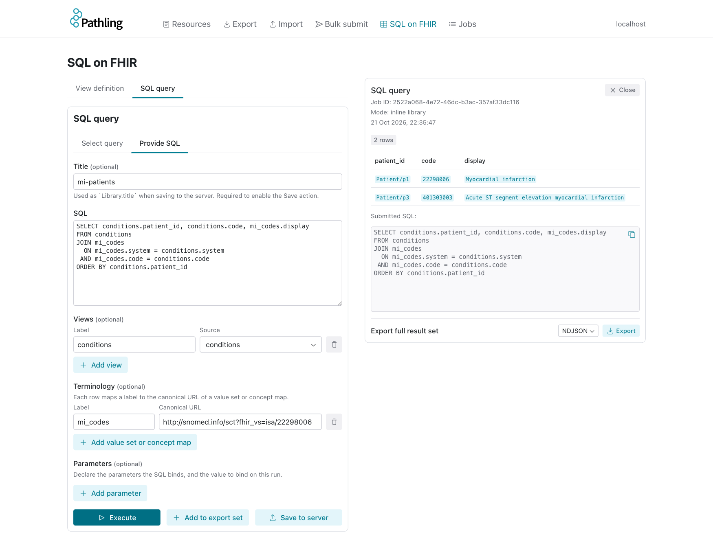

We've just released Pathling 10.0.0 and Pathling server 3.1.0. The main new
feature in both is support for
[Terminology in SQL](https://build.fhir.org/ig/HL7/sql-on-fhir/en/terminology-in-sql.html),
a part of the SQL on FHIR specification that lets a SQL query use value sets and
concept maps as ordinary tables.

<!-- truncate -->

## Why tables?

Most analyses of FHIR data need to ask a terminology question at some point.
"Which patients have had a myocardial infarction?" is a question about value set
membership. "What is the ICD-10 code for each of these diagnoses?" is a
question about translation through a concept map.

Pathling has been able to answer these questions for some time, through the
`memberOf` and `translate` FHIRPath functions and their equivalents in the
Python, R and Java libraries. These functions work well and they scale to very
large datasets, but they are specific to Pathling. A SQL query that calls
`member_of` will not run on any other SQL on FHIR implementation. On the server,
Pathling's own functions are not permitted within SQL at all, so the only way to
use terminology within a SQLQuery was to compute it ahead of time as a column
of a ViewDefinition.

The SQL on FHIR specification takes a different approach. It defines two
tables with fixed columns: one holding the members of a value set, and one
holding the mappings within a concept map. A query declares the value set or
concept map that it needs, and the implementation supplies the content under a
name that the query can join to. Because the tables are the same everywhere,
the SQL is too.

A value set table has one row per member:

| Column     | Content                                       |
| ---------- | --------------------------------------------- |
| `system`   | The code system of the member                 |
| `version`  | The code system version, where known          |
| `code`     | The member code                               |
| `display`  | The display text for the code                 |
| `inactive` | `true` where the code is known to be inactive |

A concept map table has one row per mapping, with `source_system`,
`source_version`, `source_code` and `source_display` on one side,
`target_system`, `target_version`, `target_code` and `target_display` on the
other, and a `relationship` column that describes how the two are related. The
relationship uses the R5
[ConceptMapRelationship](https://hl7.org/fhir/valueset-concept-map-relationship.html)
codes. Pathling holds R4 resources, so the R4 `equivalence` is converted, e.g.
`narrower` becomes `source-is-broader-than-target`.

A table also gives you things that a boolean function cannot. You can bring the
display text of the matching member alongside your data, filter on `inactive`,
translate in the reverse direction by joining on the target columns, and
combine membership and translation with any other join in the same query.

## Using it from the libraries

`PathlingContext` has four new methods that return a value set or concept map
as a Spark DataFrame. Register the DataFrame as a view, and SQL can join to it
under that name.

| Python                  | R                                | Java and Scala       |
| ----------------------- | -------------------------------- | -------------------- |
| `value_set`             | `pathling_value_set`             | `valueSet`           |
| `value_set_from_json`   | `pathling_value_set_from_json`   | `valueSetFromJson`   |
| `concept_map`           | `pathling_concept_map`           | `conceptMap`         |
| `concept_map_from_json` | `pathling_concept_map_from_json` | `conceptMapFromJson` |

Here is an example that projects some Conditions into a table using a view
definition, and then finds the ones that are a type of myocardial infarction
using a SNOMED CT ECL value set:

```python
from pathling import PathlingContext, to_ecl_value_set

pc = PathlingContext.create()
data = pc.read.ndjson("/data/fhir")

data.view(
    "Condition",
    select=[
        {
            "column": [
                {"name": "patient_id", "path": "subject.getReferenceKey(Patient)"},
                {"name": "system", "path": "code.coding.first().system"},
                {"name": "code", "path": "code.coding.first().code"},
            ]
        }
    ],
).createOrReplaceTempView("conditions")

pc.value_set(
    to_ecl_value_set("<< 22298006 |Myocardial infarction|")
).createOrReplaceTempView("mi_codes")

pc.spark.sql("""
    SELECT conditions.patient_id, conditions.code, mi_codes.display
    FROM conditions
    JOIN mi_codes
      ON mi_codes.system = conditions.system
     AND mi_codes.code = conditions.code
    ORDER BY conditions.patient_id
""").show(truncate=False)
```

```
+----------+---------+------------------------------------------------+
|patient_id|code     |display                                         |
+----------+---------+------------------------------------------------+
|Patient/p1|22298006 |Myocardial infarction                           |
|Patient/p3|401303003|Acute ST segment elevation myocardial infarction|
+----------+---------+------------------------------------------------+
```

Where you only need to know whether a code is a member, a semi-join
(`WHERE EXISTS`) is the safer choice. A value set can hold the same code under
more than one version of a code system, and an inner join on `system` and
`code` would then return the row twice.

Translation uses a `LEFT JOIN`, so that codes the map does not translate are
kept. This example reads a concept map from a JSON file. It maps three of the
four codes to ICD-10, and states that the fourth (asthma) has no mapping:

```python
with open("sct-to-icd10.ConceptMap.json") as f:
    pc.concept_map_from_json(f.read()).createOrReplaceTempView("sct_to_icd10")

pc.spark.sql("""
    SELECT conditions.patient_id,
           conditions.code,
           sct_to_icd10.target_code,
           sct_to_icd10.relationship
    FROM conditions
    LEFT JOIN sct_to_icd10
      ON sct_to_icd10.source_system = conditions.system
     AND sct_to_icd10.source_code = conditions.code
     AND (sct_to_icd10.relationship IS NULL
          OR sct_to_icd10.relationship <> 'not-related-to')
    ORDER BY conditions.patient_id
""").show(truncate=False)
```

```
+----------+---------+-----------+-----------------------------+
|patient_id|code     |target_code|relationship                 |
+----------+---------+-----------+-----------------------------+
|Patient/p1|22298006 |I21        |equivalent                   |
|Patient/p2|73211009 |E14        |source-is-broader-than-target|
|Patient/p3|401303003|I21.3      |equivalent                   |
|Patient/p4|195967001|NULL       |NULL                         |
+----------+---------+-----------+-----------------------------+
```

The `relationship` test sits in the `ON` clause rather than in `WHERE`, because
in `WHERE` it would also remove the rows that the `LEFT JOIN` was written to
keep. It admits null because a row stating that there is no mapping has no
relationship.

The content of a value set or concept map is fetched once, when the DataFrame
is created, and held within it. Every use of the DataFrame sees the same
content, no matter how many times the query is evaluated.

See the [terminology in SQL](/docs/libraries/terminology/sql) documentation for
examples in R, Scala and Java.

## Using it on the server

On the server, a SQLQuery or SQLView declares a value set or concept map as a
`relatedArtifact` dependency, in exactly the same way that it declares a view.
The `label` is the name that the SQL uses:

```json
"relatedArtifact": [
    {
        "type": "depends-on",
        "label": "conditions",
        "resource": "https://example.org/ViewDefinition/conditions"
    },
    {
        "type": "depends-on",
        "label": "mi_codes",
        "resource": "http://snomed.info/sct?fhir_vs=isa/22298006"
    },
    {
        "type": "depends-on",
        "label": "sct_to_icd10",
        "resource": "http://example.org/ConceptMap/sct-to-icd10|2026"
    }
]
```

The SQL within the Library never names a canonical URL or a terminology
server. This query combines both kinds of terminology, keeping only exact
translations:

```sql
SELECT conditions.patient_id,
       conditions.code,
       mi_codes.display,
       sct_to_icd10.target_code AS icd10_code
FROM conditions
JOIN mi_codes
  ON mi_codes.system = conditions.system
 AND mi_codes.code = conditions.code
LEFT JOIN sct_to_icd10
  ON sct_to_icd10.source_system = conditions.system
 AND sct_to_icd10.source_code = conditions.code
 AND sct_to_icd10.relationship = 'equivalent'
ORDER BY conditions.patient_id
```

A value set or concept map that the server cannot resolve can be supplied with
the request, through the `context` parameter. Here the concept map is supplied
inline, and the value set is expanded by the terminology server:

```bash
curl -X POST 'http://localhost:8080/fhir/$sql-run' \
  -H 'Content-Type: application/fhir+json' \
  -d '{
    "resourceType": "Parameters",
    "parameter": [
      {
        "name": "subjectReference",
        "valueReference": { "reference": "Library/mi-icd10" }
      },
      {
        "name": "context",
        "resource": {
          "resourceType": "ConceptMap",
          "url": "http://example.org/ConceptMap/sct-to-icd10",
          "version": "2026",
          "...": "..."
        }
      },
      { "name": "_format", "valueCode": "csv" }
    ]
  }'
```

```
patient_id,code,display,icd10_code
Patient/p1,22298006,Myocardial infarction,I21
Patient/p3,401303003,Acute ST segment elevation myocardial infarction,I21.3
```

Every value set and concept map is resolved once, before any SQL runs, and the
server logs where each one came from. This is what was logged for the request
above:

```
Resolved value set 'http://snomed.info/sct?fhir_vs=isa/22298006' (version none) from https://tx.ontoserver.csiro.au/fhir: 135 members; expansion urn:uuid:ff2298ba-b0a8-4a14-a437-8cc981843d66 at 2026-10-21T21:29:22+10:00; code systems [http://snomed.info/sct|http://snomed.info/sct/32506021000036107/version/20260930]
Resolved concept map 'http://example.org/ConceptMap/sct-to-icd10' (version 2026) from context: 4 mappings
```

This means that a result can always be traced back to the terminology content
it was computed against. In `$sql-export`, the content is fetched at kick-off
and fixed for the life of the job, so every output in the job sees the same
membership and mappings.

The SQL query form in the admin UI can now bind a label to a value set or
concept map, alongside the views:



Read the docs:
[terminology in SQL](/docs/server/sql-on-fhir#terminology-in-sql).

## Where the content comes from

The content of a value set or concept map comes from wherever Pathling is
configured to get its terminology:

- **A terminology server** - value sets are expanded using `ValueSet/$expand`,
  and concept maps are found by searching the server's ConceptMap resources.
- **The [local terminology store](/blog/local-terminology)** - value sets are
  computed from the imported content, including SNOMED CT ECL and
  [VCL](https://build.fhir.org/ig/FHIR/ig-guidance/vcl.html) implicit value
  sets. Concept maps come from imported ConceptMap resources, and from the
  SNOMED CT implicit maps for the four association reference sets (POSSIBLY
  EQUIVALENT TO, REPLACED BY, SAME AS and ALTERNATIVE).
- **JSON** - a ValueSet or ConceptMap supplied directly, through the
  `_from_json` methods in the libraries or the `context` parameter on the
  server. A ValueSet with an expansion is used as-is, so this works without any
  terminology service at all.

## Things to be aware of

The tables are a complement to the terminology functions, not a replacement.
The content of each table is held in memory before the query runs, so its size
is capped at 100,000 members or mappings by default. The cap can be raised
(`max_members` and `max_mappings` in Python and R, and
`pathling.sqlQuery.valueSetMaxMembers` and
`pathling.sqlQuery.conceptMapMaxMappings` on the server), but a value set such
as all the descendants of "Clinical finding" is better served by `memberOf`,
which never needs to expand it.

A value set or concept map that cannot be resolved is an error, never an empty
table. A query that silently returns no rows because the terminology was
missing is a hard problem to spot, so we have tried to make sure that this
can't happen. The same goes for a concept map with content that a flat table
cannot represent, such as targets that carry `dependsOn` or `product`.

We also recommend pinning the version of each value set and concept map where
you can, e.g. `http://example.org/ValueSet/cardiovascular-disease|2026`. An
unpinned reference can return different content each time the artefact is
republished, and two runs of the same query can then return different results.

## Other changes

Pathling 10.0.0 also includes:

- **Breaking:** `memberOf` now follows the FHIR definition. It returns empty
  for input with more than one item, accepts `code` and `string` input, and
  returns empty (or null from the `member_of` function) where membership cannot
  be determined.
- **Breaking:** `getReferenceKey()` now returns empty for absolute URLs,
  contained references and URNs, and strips the `/_history` version from a
  versioned reference.
- **Breaking:** The local terminology store format has changed. A store
  written by 9.9.0 is migrated in place when it is first opened, after which
  9.9.0 can no longer read it.
- Local terminology mode now handles large concept maps within bounded memory,
  supports SNOMED CT simple map reference sets in `translate`, and verifies FHIR
  packages against the checksum published by the registry.
- New `startsWith()`, `endsWith()` and `contains()` FHIRPath functions,
  contributed by [@chgl](https://github.com/chgl).

Server 3.1.0 also adds support for external tables. An operator can configure
a read-only Delta or Parquet table outside the warehouse, which a SQLQuery or
SQLView can then declare as a dependency and join to its FHIR views.

The full list of changes is in the release notes for
[10.0.0](https://github.com/aehrc/pathling/releases/tag/v10.0.0) and
[server 3.1.0](https://github.com/aehrc/pathling/releases/tag/server-v3.1.0).

## Getting started

```bash
pip install pathling
```

```bash
docker run -p 8080:8080 ghcr.io/aehrc/pathling:3
```

Hopefully this makes it easier to write terminology-aware queries that can be
shared and run on any SQL on FHIR implementation. Let us know what you think!
