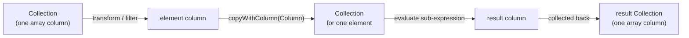
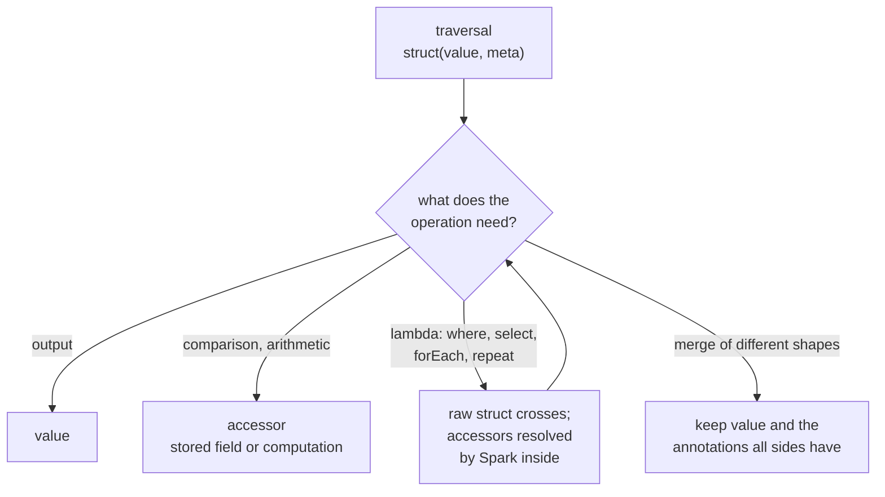
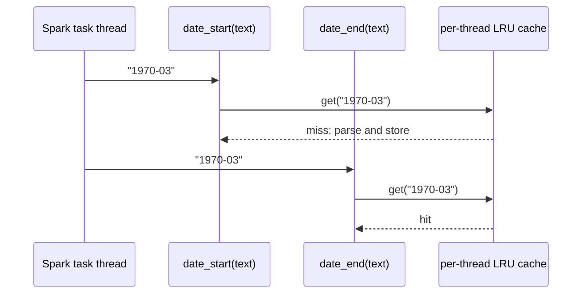

# Annotations and primitive metadata in the FHIRPath engine

**Status:** Proposal for review · **Date:** 2026-11-02, revised 2026-11-06 · **Tickets:**
42, 43, and a new review of FR-005 · **Spec:** `specs/001-parquet-on-fhir/spec.md` FR-002,
FR-004, FR-005, FR-021–FR-023, FR-059 · **Decisions:** 140–150 in
`evidence/decisions.md`; the full record is `evidence/annotations-decision-record.md` ·
**Examples:** [`annotations-by-example.md`](annotations-by-example.md)

## Summary

1. **One column per element stays.** A FHIR primitive is held in the engine as one
   struct, `struct(value, meta)`, where `meta` holds the primitive's **named stored
   annotations** only (D2, decision 141). Its `id` and `extension` are carried only when
   a switch, off by default, turns them on (D14). This is the pairing decision 135 already
   chose. It fits the existing evaluation model without change.
2. **Annotations are accessors, not data.** Nothing is computed when a value is
   traversed. An operation that needs an annotation asks for it. The engine then
   reads the stored field, or computes it if the schema does not carry it. Spark makes
   that choice when it resolves the plan, so the engine stays schema-agnostic.
3. **FHIR and System values have different shapes.** Both carry annotations; only FHIR
   values carry ids and extensions. Converting a FHIR value to System keeps its stored
   annotations and drops the rest, with a deferred projection that keeps only the
   annotation fields the schema has. Nothing is computed.
4. **A primitive's external output is its value**, never its metadata.
5. **Every annotation is one flat scalar field.** A computation that several annotations
   share is memoised per thread, so the layout does not need to group fields to avoid
   computing twice.

## 1. Background

### How the engine evaluates

Every FHIRPath expression evaluates to a `Collection` backed by **one Spark column**. A
singular element is a scalar column and a repeating element is an array column. Functions
such as `where()` and `select()`, and the view operators `forEach` and `repeat`, iterate
with Spark's `transform` and `filter`. Inside the lambda, each element column is wrapped
back into a `Collection`, so another expression can be evaluated against it.



The design depends on this. It can be seen in the code:

- `UnnestingSelection`, `RepeatSelection` and `ProjectionClause` build each element from
  `getColumnValue()` alone.
- `ProjectionContext.withInputColumn` rebuilds a collection from **one** `Column`.
- `repeat` uses `transformTree` with Column → Column steps. So a path's output for one
  element must be valid input for the next level ("closure").

### How the data is stored

Parquet on FHIR stores a primitive's value and its metadata in **separate fields**, as
FHIR JSON does: `x` holds the value, and `_x` holds its id, extensions and annotations.

```json
{ "birthDate": "1970-03",
  "_birthDate": { "extension": [ { "url": "…/birthTime", "valueDateTime": "1970-03-30T14:00" } ] } }
```

```
birthDate  : string                                  "1970-03"
_birthDate : struct<id, extension, __start, __end>   { extension: [...],
                                                       __start: 1970-03-01T00:00:00.000,
                                                       __end:   1970-03-31T23:59:59.999 }
```

For a repeating primitive, the two arrays are aligned by position:

```
name.given  : array<string>                      ["Anne", "Mary"]
name._given : array<struct<id, extension>>       [null, { extension: [...] }]
```

**The problem:** a primitive's value lives in two columns, and the evaluation model can
iterate over only one.

## 2. What clients need from the engine

| Client | Needs |
|---|---|
| `forEach`, `forEachOrNull`, `where`, `select` | One column per element |
| `repeat` | One column per element, closed under the path |
| View columns (`Materializable.toExternalValue`), `$fhirpath` (`getOutputColumn`) | The **external value** of each element |
| Search (`SearchColumnBuilder`, `DateMatcher`) | Predicates on stored bounds that Parquet can push down |
| All | A traced operand fires once (#2594); `%rowIndex` advances once per element; an element's SQL type does not depend on which annotations exist (FR-022, FR-023); `unionAll` sees consistent types |

No client reads the engine's internal form. **It is free to change**, as long as the
needs above still hold.

**Constraint: metadata that is present but not used costs nothing** (owner, 2026-11-02).
A primitive's ids and extensions, which may be stored in any row, must not slow down an
expression that does not use them. The same holds for annotations an expression does
not read. "Costs nothing" means no extra bytes read from Parquet and no extra
computation, compared with the same expression over data without that metadata.
Extensions on primitives are rare, but where they are present they are the bulk of
`_x`, so carrying them unused is the dominant cost: about 10–14× the bytes read on
extension-heavy data ([evidence](../evidence/annotations-design-singular-meta-pruning.md)).

Spark cannot prune an unused field through a higher-order function or a view's
`Generate`, so this constraint is met only by the element **not referencing** metadata
that the expression does not use. A field that the element references is read in full,
whether or not anything reads it later.

The constraint is a target for the final solution, not a release gate (owner,
2026-11-04). The release gate is H1: release 11 is not slower than 10.x on the
SQL-on-FHIR benchmarks. §4.1 meets the constraint for ids and extensions by leaving
them out of the element unless the switch turns them on (D14). The remaining
exceptions, such as annotation fields read when only the value is output, and
repeating primitives below a repeating parent, are listed under §6, question 5.

## 3. What the engine does today

The engine already pairs `x` with `_x` at traversal, inside the parent's lambda, where
both are fields of one parent struct. What it builds from the pair differs by type:

| Type | Engine form | Output |
|---|---|---|
| decimal | A numeric scalar; **the text is dropped** | Re-rendered from the numeric value |
| date, dateTime, instant | `struct(value, range{__start, __end})`, computed **eagerly** | `value` |
| Quantity | The stored struct, converted when used (`toEngineForm`) | Fitted shape (FR-059) |

The eager date range has costs, recorded in tickets 42 and 43:

- **Inside a lambda, the unused range is not pruned.** A date under a repeating parent
  is parsed even when it is only output (ticket 43, finding 2).
- **Pushdown is blocked.** The `CASE WHEN` that builds the struct, and `bindOnce`,
  hide `__start` from Parquet's filter translation (ticket 43, finding 5).
- **The computation decides the layout.** `__start` and `__end` are grouped, and bound
  with `bindOnce`, only so that one parse serves both (ticket 42).

## 4. Design

### 4.1 Element form

A FHIR primitive's element is one struct of its value and its **named stored
annotations** (D2, decision 141):

```
element = struct(value, meta)
meta    = the named annotation fields of _x that the schema has:
            date, dateTime, instant   __start, __end
            decimal                   __numeric
          plus id and extension, only when the primitive-extensions switch is on (D14)
```

It is built at traversal, by pairing by position in the parent's lambda, as today.
`meta` is projected from `_x` by named field reads, `resolve_or_none(_x, [fields])`
(§4.3). It is never the raw `_x` group. Only **stored fields** go into it; nothing is
computed. A field that the schema lacks is left out, not filled with null. The value is
the stored value: for a decimal, its text.

The raw `_x` is not carried because it is read in full wherever the element is
referenced, extensions included. On 1M Patients with extension-heavy `_birthDate`, a
raw `_x` read 182.4 MB against 17.6 MB for the named fields
([evidence](../evidence/annotations-design-singular-meta-pruning.md)).

**Primitive ids and extensions are behind a switch, off by default (D14, decision
141).**

| Switch | `meta` carries | `x.extension(…)`, `x.id` on a primitive |
|---|---|---|
| Off (default) | Annotations only | Empty, as if `_x.id` and `_x.extension` were absent from the JSON; no error |
| On | Annotations, `id` and `extension` | As stored. Every such element reads its whole `_x`; the cost falls only on users who opt in |

Annotations are never switched off. The switch is configuration, not an analysis of
the expression: the element's content is fixed for a given setting (principle P0,
decision 140: rely on Spark's own optimiser, with no FHIRPath-level analysis of which
fields an expression uses).

Example: `Patient.name.given`, switch on

```
name       : [ { given: ["Anne","Mary"], _given: [null, {extension:[…]}] } ]
elements   : [ {value:"Anne", meta:null}, {value:"Mary", meta:{extension:[…]}} ]
```

With the switch off, a string has no annotations to carry, so its element is the bare
value, as today.

This keeps one column per element, so `where`, `forEach` and `repeat` work unchanged:

```
name.given.where(extension('…/nickname').exists())     // reads meta.extension (switch on)
name.given                                             // outputs value only
```

### 4.2 FHIR and System values

| | FHIR primitive | System value |
|---|---|---|
| Comes from | Traversal of stored data | Conversion from FHIR, literals, functions |
| Element | `struct(value, meta)` | `struct(value, ann)` |
| Ids and extensions | Only with the switch on (D14), in `meta` | No |
| Annotations | Yes: the stored ones in `meta`, the rest on demand | Yes: the available ones in `ann`, the rest on demand |
| Schema | Varies by path (fitted to the data) | Varies with which annotations are available |

`ann` holds only the annotation fields that are available without computing. Where they
come from depends on how the System value was made:

| System value comes from | Its annotations |
|---|---|
| Conversion from FHIR (D8, decision 142) | `resolve_or_none(meta, [annotation fields])`: the stored annotation fields that exist; `id` and `extension` are dropped |
| A literal, `@2000` | Constants built at plan time |
| A function, such as `toDate()`, date arithmetic or `now()` | Computed on demand from `value`, or supplied directly by a function that already knows them |

Combining a FHIR value with a System value converts the FHIR side to System, as
quantities already do. A System value never carries ids or extensions.

`System.Decimal` is the number only (D13, decision 147): a bare `DECIMAL(38,6)`. A FHIR decimal's text
is not kept as an annotation when it converts.

**A complex System value has only the fields a literal can set (decision 150).** Its
annotations follow the same rules as a primitive's: in `ann` where available without
computing, otherwise computed by an accessor where an operation reads them.

| Type | Fields | `ann` |
|---|---|---|
| System.Quantity | `value` (`DECIMAL(38,6)`), `unit`, `code`, `system` | `__canonical_code`, `__canonical_value_exact` |
| System.Coding | `system`, `code`, `version`, `display`, `userSelected` | None |

- **System.Quantity:**
  - `value` is a System.Decimal, so it is a bare `DECIMAL(38,6)` (D13, decision 147). It
    is the number, so there is no `__numeric`.
  - `unit` is the unit as written (`days` in `4 days`) and `code` its code (`day`). The
    exact-unit match reads `unit`.
  - `system` is implied by the literal's form: a quoted unit is UCUM, a calendar keyword
    is a calendar duration, and no unit is UCUM `'1'`.
  - There is no `id`, and no `comparator`: a FHIR quantity with a comparator has no
    System form.
  - Converting a FHIR quantity takes its stored canonical fields into `ann` and computes
    nothing (D8).
  - **The canonical form is computed from the most exact source, never from the converted
    decimal.** Otherwise an unannotated dataset could compare differently from an
    annotated one, whose canonical form ingest computed from the full stored text.

    | Quantity from | Canonical form from |
    |---|---|
    | Stored data | The stored annotation, or else the stored text. The comparison's accessor resolves it on the FHIR operand, which is converted where it is compared (`StoredQuantityComparator`) |
    | A literal | The literal's text, as constants at plan time |
    | Arithmetic | Its `DECIMAL(38,6)` value; no text ever existed |

    A merge of a FHIR quantity with a System one (`a | 5 'kg'`, `iif`) keeps the stored
    canonical fields only if every side has them (§4.4); otherwise its canonical form is
    computed from the decimal. That differs only beyond six fractional digits, where every
    System.Decimal already loses them.
  - The canonical form is no longer always filled, which amends FR-059.
- **System.Coding:** a FHIR Coding's `id` and `extension` are dropped when it converts,
  as a primitive's are.

Example: `72.50 'kg'`, a literal

```
{ value: 72.500000, unit: "kg", code: "kg", system: "http://unitsofmeasure.org",
  ann: { __canonical_code: "g", __canonical_value_exact: { value: 72500, scale: 0 } } }
```

#### Suggestion, not decided: System types with fields of their own

The owner has suggested a different framing of System values (2026-11-05). It is not a
decision, and goes to a follow-up issue on presence-driven algorithm choice (P1,
decision 148, through ticket 26). Until then the tables above stand.

In this framing, annotations exist only on the FHIR, stored, side. A System type has
first-class fields of its own, each **required** or **optional**. Converting FHIR to
System fills a required field from the stored annotation, or computes it where nothing
is stored. It sets an optional field to null where nothing is stored, and a null then
means "not available: use the algorithm that does not need it". Suggested shapes:

| Type | Shape |
|---|---|
| FHIR primitive | `struct(value, meta)`, as in §4.1 |
| System.Date, DateTime, Instant | `{value, __start, __end}`, all required |
| System.Time | `{value}`; the layout has no range for it |
| System.Decimal | A bare `DECIMAL(38,6)` (D13) |
| System.String | `{value, __hash}`, with `__hash` optional (the owner's example) |
| System.Integer, System.Boolean | Bare scalars |
| System.Quantity | `{value, unit, code, system}` with `value` a `DECIMAL(38,6)` (decision 150), and `__canonical_code` and `__canonical_value_exact` as required fields |
| System.Coding | `{system, code, version, display, userSelected}` (decision 150) |

To settle in the follow-up:

1. **Where a required field is computed.** Owner's answer (2026-11-06): **only where an
   operation reads it**, so conversion still computes nothing (D8). The reasoning:
   filled at conversion, it departs from D8
   ("conversion computes nothing") and from the shapes above, which vary with the
   available annotations. Spark drops an unused field of a struct it builds only when
   the field is read directly from that struct. Where the struct sits in an array read
   by a later `transform`, or passes through a view's `Generate`, every field is
   computed for every element. An eager range costs 4–4.6× on a date that is only
   output ([evidence](../evidence/annotations-design-repeating-cpu.md)). So a required
   field means one that can always be obtained: it is read through the accessor
   `resolve_or_else` (§4.3), and computed only where it is read.
2. **Canonical names.** System.Quantity's annotations use the names of the proposed
   stored layout, `__canonical_code` and `__canonical_value_exact` (§4.7, D6, decision
   149, the spec owner's call), so that a computed quantity written back matches the
   stored layout.
3. **What an optional null means.** The rule that an absent annotation is never filled
   with null (§4.4) covers stored `meta` only. An optional System field may be null,
   and that null selects the algorithm. A fixed System shape also gives `unionAll` and
   merges consistent types, so the intersection of §4.4 would be needed on the FHIR
   side only.
4. **Cost of wrapping.** A struct System.String wraps every computed string. It could
   stay a bare string until something uses `__hash`.

### 4.3 Annotations are accessors

An annotation is a function the engine applies to an element. It is decided from the
schema (FR-023): the stored field if the schema carries it, otherwise the computation
(FR-022).

**The engine stays schema-agnostic.** The planner never inspects the schema. It emits a
deferred expression, and Spark chooses the branch once the element's type is resolved.
This is today's `ColumnFunctions.resolveOrElse`, a `RuntimeReplaceable` expression:

```
resolve_or_else(e.meta, "__start", date_start(e.value))
  → GetStructField(e.meta, "__start")    where meta's type has __start  (stored)
  → date_start(e.value)                  otherwise                      (computed)
```

The stored case resolves to a plain field read, which Parquet can prune and push down.
The same expression works inside a lambda, where Spark knows the lambda variable's type
by the time it resolves the expression.

Building a System value needs a second deferred expression, **`resolve_or_none`**
(proposed). It projects the listed fields that the type has, and leaves the rest out
entirely:

```
resolve_or_none(e.meta, ["__start", "__end"])
  → struct(__start, __end)     where meta's type has both
  → struct(__start)            where it has only __start
  → no annotations             where it has neither
```

A field it leaves out is later read as absent, so the accessor computes it. This differs
from `resolve_or_null`, which would produce the field as null, and a null stored
annotation is read as an absent value.

```
start(e)   = e.meta.__start          if the schema of meta (or ann) has __start
           = date_start(e.value)     otherwise
numeric(e) = e.meta.__numeric        if the schema of meta (or ann) has __numeric
           = to_decimal(e.value)     otherwise
```

The same accessors serve FHIR and System values. For a literal, the stored field is a
constant.

An operation asks only for what it needs:

| Expression | Builds |
|---|---|
| `Patient.birthDate` (output) | `value` |
| `Patient.birthDate > @2000` | The bounds the comparison needs: stored fields on the left, constants on the right |
| `birthdate=ge2000` (search) | `meta.__end` as a plain attribute, so it can be pushed down (`ge` is decided by the target's upper bound) |

Unused annotations are never built, so there is nothing for Catalyst to prune.

### 4.4 Keeping it lazy across boundaries



**Invariant:** only an accessor, emitted by the operation that consumes the annotation,
ever computes one. Traversal, conversion to System, crossing a lambda and merging never
fill an annotation in. An absent annotation stays absent; it is never filled with null,
because a null stored annotation is read as an absent value.

| Step | Annotations | Computes |
|---|---|---|
| Traversal | `struct(value, meta)`, `meta` the named stored annotations (§4.1) | No |
| FHIR → System | `resolve_or_none`: stored annotation fields only; `id` and `extension` dropped | No |
| Crossing a lambda | Raw struct crosses | No |
| Merge | `resolve_or_none` over the fields every side has; a literal's are constants | No |
| Function result, such as `toDate()` | `value` only (rule A, §6 question 6) | No |
| Accessor, such as `start(e)` in a comparison | `resolve_or_else(e.meta, "__start", date_start(e.value))` | Only where nothing is stored |

1. **Within one expression:** the accessors build only what the operation reads.
2. **Across a lambda:** only the raw `(value, meta)` crosses. Inside, the accessors emit
   the same deferred expressions on the lambda's element, and Spark resolves them per
   schema. This fixes ticket 43, finding 2.
3. **Merging different shapes** (`a | b` with one side annotated and one not, a FHIR
   date with `@2000`, `iif` branches, `repeat`'s element type, `unionAll`): the result is
   a System value that keeps `value` and the annotation fields **every side has**. The
   rest are computed on demand. For example, `birthDate | @2000` over annotated data
   keeps the stored bounds, because the literal has them too; over unannotated data, the
   bounds are computed. A merge of identical FHIR shapes keeps `meta`.

   The planner cannot tell whether shapes differ, so the existing deferred reconciler
   (`MergeCast` and `UnresolvedMergeCombination`, ADR-0002) decides, with one new rule:
   **annotation fields are intersected, not unioned.** It finds the annotation fields
   every operand has, and projects each operand with `resolve_or_none` over that set.
   `id` and `extension` are unioned for a FHIR result, and dropped for a System one. Unioning an annotation would fill it
   with null on the side that lacks it, and a null stored annotation is read as an absent
   value. That would be silently wrong.

### 4.5 External output

| Value | Output |
|---|---|
| System value | Its value |
| FHIR primitive | `value` as stored (D10, decision 142), whether the switch is on or off |
| A primitive's `meta` | **Never** output as part of the primitive |
| Ids and extensions | Only when navigated to (`.extension(…)`, `.id`, switch on), or inside a complex value output in its fitted shape (FR-059), `_x` included |

**Decimals** are output by result type (D13, decision 147). The engine tells a stored decimal from a
computed one by the collection's definition, as it does for Quantity. It does not
inspect the schema. A union is stored only if all its operands are.

| Path | Stored decimal (`FHIR.decimal`) | Computed decimal (`System.Decimal`) |
|---|---|---|
| View column (already `STRING`) | Today: the trimmed `DECIMAL(38,6)` text, so a stored `1.50` gives `"1.5"`. With ticket 16 (lexical decimals): **its stored text**, `"1.50"`. Only the values change, not the column type | The trimmed `DECIMAL(38,6)` text |
| `fhirPathToColumn`, `$fhirpath` | `DECIMAL(38,6)` | `DECIMAL(38,6)` |
| `toString()` | Its stored text | As today |

Keys and comparisons stay numeric. The detection of stored against computed decimals is
built now (ticket 41), and the view output switches to the stored text in one change when ticket 16
lands. What `fhirPathToColumn` and `$fhirpath` return in general is specified by ticket
40, which absorbed ticket 47. Because of this, a decimal's element keeps `value`, its text, from now on.

### 4.6 Shared computation: memoise, do not group

`__start` and `__end` both come from one parse of the text. Instead of grouping them so
that the parse runs once, each annotation is its own scalar UDF over a **memoised** parse:



A Spark task evaluates its rows one by one on one thread, so a `ThreadLocal` cache needs
no locking, and a row that reads no annotation costs nothing. The date range is already
a Java UDF (`DateRangeKind`), so the cache is plain Java and `fhir-schema` keeps to the
public Spark API.

Conditions:

- **An LRU of about 16–64 entries, not the last input only.** A plan can read the
  fields in separate passes, `transform(a, start)` then `transform(a, end)`. That gives
  s(a1), s(a2), … e(a1), e(a2), which a cache of one entry always misses.
- **Results do not change.** Cached values are immutable, the UDFs stay deterministic,
  and a parse failure is handled in each call, never cached.
- **#2594 still applies.** The cache saves the computation, but each field still
  evaluates its input. A traced input is still bound with `SqlFunctions.let`.

A miss costs one extra parse, never a wrong result.

### 4.7 Stored layout: flat annotations

Every annotation is one scalar field, in the container its element owns (decision 135).

| Type | Fields | Example |
|---|---|---|
| date, dateTime, instant | `__start`, `__end` (upstream names) | `_birthDate.__start` |
| decimal | `__numeric` | `_valueDecimal.__numeric` |
| Quantity | `__canonical_code`, `__canonical_value_exact` (FlexiDecimal). Pathling does not write `__canonical_value` at the spec's fixed scale (§6, question 4) | `valueQuantity.__canonical_value_exact` |

The quantity follows the legacy (Bunsen) line, which already stores the canonical form
flat, exact and inside the element:

| Legacy | Proposed |
|---|---|
| `_code_canonicalized` (string) | `__canonical_code` |
| `_value_canonicalized` (FlexiDecimal) | `__canonical_value_exact` |

This replaces today's `__canonical_exact: struct<value FlexiDecimal, code>`, and
supersedes decision 137. The name says *code*, not *unit*: in FHIR, `Quantity.unit` is
the display text, and canonicalisation yields a UCUM code.

**There is no canonical system field.** Only a quantity whose system is UCUM, or a definite
calendar duration (`second`, `millisecond`), is canonicalised, and the result is always in
UCUM base units, so the canonical system would be `http://unitsofmeasure.org` in every row.
A quantity in any other system has no canonical fields, and its own `system` is stored
unchanged. Neither today's `__canonical_exact` nor the legacy line carries one. A system field
would be needed only if another system were canonicalised with codes that could collide with
UCUM's, which would be a new kind (decision 135 keeps the set closed).

**A field missing from the schema is harmless.** Each field is decided separately
(FR-023). If the schema has `__start` but not `__end`, the lower bound is read and the
upper bound is computed, with one parse thanks to the cache. Inconsistencies within a
row, such as a null annotation beside a present value or a stale annotation, are left
to validation and `trust` (tickets 31 and 38) under any layout.

## 5. Alternatives

| Option | Idea | Why not now |
|---|---|---|
| **B: several columns** | A representation holds parallel `values` and `groups` arrays and zips them only at lambda boundaries | It zips at every `where`, `forEach` and `repeat` anyway, because of closure. It must keep positions aligned through `removeNulls` and `flatten`, handle `_x` without `x` (decision 72), and must not duplicate traced operands. Held as a fallback if A is markedly slower. |
| **C: a Catalyst rule** | Keep A, and add a rule that simplifies a field read through the engine's struct and `CASE WHEN` builders | Adds a custom rule to maintain across Spark upgrades. Held as a fallback if A cannot prune or push down. |
| **D: store pre-zipped** | Store `array<struct{value, id, extension, …}>` | Breaks the PoF spec's JSON-shaped layout, the JSON projection (ticket 35) and legacy parity. |
| **Grouped annotations** *(for review)* | `__bounds{low, upper}` and `__canonical{value, code}` as structs | The struct guarantees that both fields are in the schema, but its fields are still nullable in every row, and it brings back grouping in the engine. It deviates from upstream's flat `start` and `end`. **To discuss.** |
| **Renaming to `__bound_low` and `__bound_upper`** | Match FHIRPath's `lowBoundary()` and `highBoundary()` | Deviates from upstream with no functional gain. |

## 6. Open questions

1. **Grouped or flat annotations.** Flat is proposed; grouped is the alternative to
   discuss (§5).
2. **`$fhirpath` results on the server.** Decided (owner, 2026-11-06): a FHIR primitive
   in a typed `Parameters` result carries its value only, as every other external
   output does (§4.5). Its extensions are returned only when the expression asks for
   them with `extension()`.
3. **Upstream, through ticket 46:** propose flat quantity annotations, and point out that
   the spec's `canonical` table (`{value, code}`) contradicts its example, which shows a
   whole canonicalised Quantity.
4. **Whether to emit `__canonical_value`** (the spec's fixed scale) beside the exact
   value. Decided (owner, 2026-11-06): no; Pathling writes the exact value only. The
   fixed-scale value would let quantity comparisons skip row groups, and is a
   candidate for the performance follow-up raised through ticket 26.
5. **How the element meets the §2 constraint on unused metadata.** Decided in decisions
   140, 141 and 143:
   - The element carries the named annotations, not the raw `_x` (D2), and ids and
     extensions only with the switch on (D14). The engine does no FHIRPath-level
     analysis of which fields an expression uses (P0), so shaping each element per
     expression (L1) is not built.
   - Reads are pruned by the shapes the engine emits (L2, decision 143): compute-first, existence
     rewrites, and pairing a repeating primitive with
     `arrays_zip(x, _x.__start, _x.__end)`, each extracted array guarded with
     `coalesce(x, array())`. Tests assert the plan shape and equal results.
   - Known exceptions: a singular annotated output reads its annotation fields;
     `period.start` reads `_start`; a repeating primitive below a repeating parent reads
     its whole `_x`; and on Spark 4.0–4.2 most views still read their repeating parents
     whole (on 4.0.2 these shapes pruned 4 of 26 views).
   - A Catalyst rule that prunes through higher-order functions (option C, D3b) is a
     separate optimisation experiment, tried regardless, and not the remedy for an H1
     regression ([evidence](../evidence/annotations-design-lambda-pruning-rule.md)).
6. **Which form is the truth for a computed System value.** Deferred (owner,
   2026-11-06) until quantity or date arithmetic is designed; neither is implemented
   (`MathOperator` rejects both). A System value with annotations holds two forms of
   one value, and an operation that changes `value` but passes its operand's `ann`
   through leaves a stale annotation. The accessor prefers a present annotation, so
   later comparisons would be silently wrong.
   - **Default until then, rule A:** an operation that produces a new value produces no
     annotations. Annotations enter a System value only by conversion from FHIR, as
     literal constants, or by a merge (§4.4); any other result is `value` only, and an
     accessor computes an annotation where it is read. The one value-changing function
     on an annotated type today, `toQuantity(unit)`, may instead carry the canonical
     form over, because a change of unit leaves it unchanged.
   - **Quantity, to consider:** a two-way form. `unit`, `code` and `system` are
     required; `value` and the canonical form are each optional, at least one present,
     and each derived from the other where absent (UCUM in either direction). An
     operation writes only the form it computed: cross-unit `+` and `-` in canonical
     space write the canonical form, and the value is derived where read. A quantity
     with no canonical form (not UCUM, or a calendar duration above seconds) must carry
     `value`. This would amend decision 150's rule that arithmetic takes its canonical
     form from the decimal.
   - **Dates, to consider:** the range cannot be the truth. It loses the offset and the
     absence of a timezone, and date arithmetic is not closed over ranges
     (`@2024-02 + 1 month`, and the clamping of Jan 31 + 1 month). A structured form,
     `{local timestamp, precision, offset}`, from which both the range and the text
     derive, is the candidate.
   - **Tests:** the ticket that builds the arithmetic adds a test-time check that every
     System value it produces has `ann` equal to what its accessor would compute.

## 7. How the design is validated

Ticket 43's plan tests, run against today's code first as a baseline:

- An output-only date under a repeating parent, with no date computation in the
  optimised plan, and the same after `where()`.
- A merge of different shapes.
- `birthdate=ge2000` and `where(birthDate >= @2000)` over annotated Parquet, checked
  against the scan's pushed filters.

Ticket 42's evidence:

- The parse runs once per value, singular and repeating, inside a lambda, and in
  separate passes.
- A traced input fires once.
- Throughput against today's grouping with `bindOnce`, on the existing benchmark.

If A is markedly slower than B or C on these, those options are reconsidered.

## 8. Consequences

- **Spec:** FR-005 is rewritten as flat quantity fields, and decision 137 is superseded.
  FR-059's System types are amended by decision 150: System.Quantity is `{value, unit,
  code, system}`, its `value` a `DECIMAL(38,6)` with no `_value` group, its flat canonical
  annotations available or computed on demand rather than always filled, and with no `id`
  or `comparator`; System.Coding has no `id`. In code, `QuantityEncoding` changes its value
  type, and the canonical accessor is emitted on the FHIR operand. Decision 135 is kept
  and refined by §4.1–4.4.
- **Code, dates:** `SystemDateTime`'s eager `range`, the struct-returning `date_range`,
  `resolveFieldsOrElse`, and `bindOnce` in `TemporalComparator` and `DateMatcher` are
  replaced by accessors and memoised `date_start` and `date_end`.
- **Code, decimals:** the element keeps its text; `__numeric` becomes an accessor.
- **Code, quantities:** `QuantityCanonicalKind` gets flat fields over one memoised
  canonicalisation, and `QuantityEncoding.compareCanonical` reads plain fields.
- **Code, views:** no change to `UnnestingSelection`, `RepeatSelection` or
  `ProjectionClause`. Accessors emit deferred expressions, so they need nothing beyond the
  column that `copyOf(Column)` already provides.
- **Code, merges:** the deferred reconciler (`MergeCast`, `UnresolvedMergeCombination`)
  intersects annotation fields, and drops `id` and `extension` for System results.
- **Code, new expression:** `ResolveOrNone`, a `RuntimeReplaceable` beside `ResolveOrElse`
  and `ResolveOrNull`, used to convert FHIR to System and in merges.

### Order of work

1. Record the decisions in tickets 42 and 43, and open the FR-005 review.
2. Write ticket 43's plan tests against today's code.
3. Prototype memoised `date_start` and `date_end`, and measure.
4. Prototype the accessor model for dates, and rerun step 2.
5. Change quantities after the FR-005 review.
